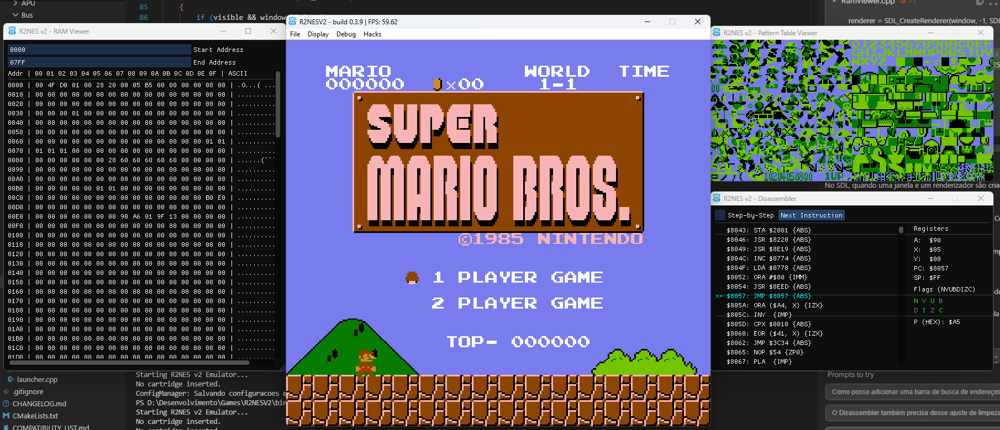
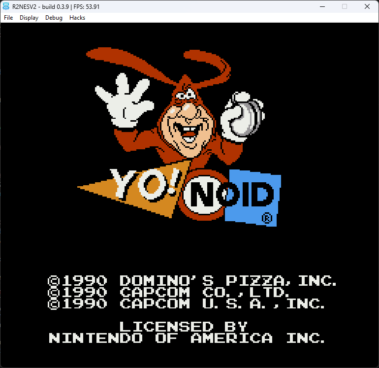
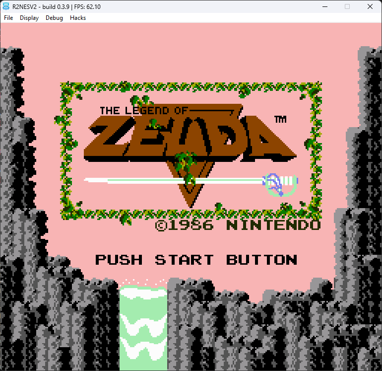

# R2NES V2

<div align="center">
  
</div>

---

R2NES V2 is a Nintendo Entertainment System (NES) emulator written in C++17. It includes a desktop interface, audio and controller support, save states, and tools for inspecting emulated video hardware.

The project is actively developed. PPU timing, mapper behavior, and compatibility are still being improved; support for a mapper does not guarantee that every game using it will work correctly.

No ROMs are included. Load your own legally obtained `.nes`, `.unf`, or `.unif` image, or a `.zip` archive containing one. UNIF support currently covers the boards listed below.

Prebuilt packages are published on the [GitHub Releases page](https://github.com/jpaulobf/R2NESV2/releases). You can also build the project from source using the instructions below.

## Features

- **CPU:** Emulation of the NES Ricoh 2A03 CPU, with bus accesses distributed across instruction cycles and synchronized with the PPU.
- **PPU:** Background and sprite rendering, scrolling, sprite priority, and Sprite 0 Hit. Timing behavior is under active development and is not fully cycle-accurate.
- **APU:** Pulse 1, Pulse 2, Triangle, Noise, and DMC audio channels, with per-channel controls.
- **Mappers:** Implementations are present for iNES mapper IDs 0, 1, 2, 3, 4, 5, 7, 9, 11, 23, 40, 66, 71, 79, 90, 147, 150, 187, and 189. Mapper 71 includes BF9097 (Fire Hawk) mirroring, with NES 2.0 submapper 1 support and legacy iNES detection. Mappers 79, 147, and 150 add support for the Sachen boards described below; mapper 147 currently implements the 72-pin latch variant. Mapper 189 combines independent 32 KiB PRG banking with MMC3 CHR banking, mirroring, and IRQs. Accuracy and game compatibility vary; see the [compatibility notes](COMPATIBILITY_LIST.md).
- **ROM loading:** iNES/NES 2.0 images and supported UNIF boards, directly or inside ZIP archives. UNIF content is recognized even when its file is named `.nes`.
- **Save states:** Three selectable slots, stored under `savestates/` and named for the loaded ROM. States verify the ROM CRC32 and mapper and restore pending OAM DMA transfers. The current `R2NK` format rejects older snapshots.
- **Battery saves (Mappers 1, 4, 5 and explicit Mapper 9 RAM extensions):** Persistent memory is restored automatically and written on ROM replacement/unload or normal emulator exit to `battery/<ROM CRC32>.sav`, relative to the working directory. SOROM/SZROM retain the second chip; MMC5 retains declared PRG-NVRAM plus its battery-backed ExRAM. MMC6 uses 1 KiB. Standard NES Punch-Out!! has no battery; Mapper 9 enables external RAM only when explicitly declared in the header.
- **Rewind:** Optional rewind with selectable precision. Snapshots are captured only while rewind is enabled; loading a ROM or save state, resetting, or unloading clears the previous rewind history.
- **Battery recovery:** Read/write failures are shown in the interface. Recognized MMC5 battery layouts can be imported explicitly with a backup; keeping the original disables automatic overwrite for that session.
- **Fast forward:** Temporarily suspends renderer VSync while preserving the menu preference. Audio output is suppressed while the APU channels, sequencer, and DMC continue to run. Turbo buttons follow emulated frames, including during fast forward.
- **Debug tools:** Viewers for VRAM, palettes, OAM, and pattern-table tiles, plus a CPU disassembler.
- **Display options:** Several palette presets, scanline and shader options, and an unlimited-sprite mode.
- **Convenience:** Recent ROM history and persistence of the last opened directory.
- **Input:** Keyboard and up to two SDL game controllers. The Zapper can be enabled for the second port and aimed with the mouse.
- **Playback and responsiveness:** Event-based waits between scheduled frames avoid busy polling when VSync is off, paused, or no ROM is loaded. Fast-forward batches return regularly to event processing; pausing, loading, and resetting clear pending audio and timing accumulators.

### Compatibility notes

Mapper coverage and PPU/APU timing are incomplete. Some games rely on board-specific mapper behavior or precise CPU/PPU timing that R2NES does not yet reproduce. A small number of ROM-specific Sprite 0 wait-loop workarounds are present; these are narrow compatibility exceptions, not general timing fixes.

The unlimited-sprite option relaxes the NES limit of eight sprites per scanline. It can reduce flicker, but changes hardware behavior; turn it off when checking the normal sprite limit or game compatibility. The sprite-overflow status bit is still set when a ninth sprite is found, so games such as *Bee 52* can observe it. This does not fully reproduce the hardware's sprite-overflow bug.

AxROM (mapper 7) applies bus conflicts only when NES 2.0 submapper 2 explicitly declares them; legacy iNES and submappers 0/1 use conflict-free banking.

The legacy iNES dump of *Street Fighter II: The World Warrior* with payload CRC32 `96CE586E` incorrectly declares mapper 187. The loader recognizes this specific dump and selects mapper 189 without modifying the ROM or ZIP. Other mapper 187 payloads retain their declared mapper. Boot testing confirmed 201 frames with visible video output; full gameplay compatibility remains unverified.

The [compatibility list](COMPATIBILITY_LIST.md) records game observations and is maintained as testing progresses. It is not a claim of complete compatibility or hardware accuracy.

### Sachen boards and UNIF

The following boards are supported through iNES/NES 2.0 mapper IDs or their UNIF `MAPR` identifiers:

| Mapper | Board / implementation | PRG-ROM | CHR-ROM | Example releases |
| --- | --- | --- | --- | --- |
| **3** | `CNROM` | 16 or 32 KiB | 8–128 KiB | *75 Bingo (Sachen-English)* |
| **79** | NINA-03/06 / Sachen `SA-016-1M` | 32 or 64 KiB | 8–64 KiB | *Galactic Crusader (Sachen)*; *Master Chu & The Drunkard Hu (Sachen)* |
| **147** | `TC-U01-1.5M`, 72-pin latch | 32 or 64 KiB | 8–128 KiB | *Challenge of the Dragon (Sachen)* |
| **150** | `Sachen-74LS374N` / SA-015 | 32, 64, or 128 KiB | 8–64 KiB | *Auto-Upturn*; *2-in-1 Cosmo Cop + Cyber Monster*; *2-in-1 Tough Cop + Super Tough Cop* |

The Sachen mappers use 32 KiB PRG and 8 KiB CHR windows, read-only CHR-ROM, and save states, without PRG-RAM or mapper IRQs. Mappers 79/147 have fixed H/V mirroring; mapper 150 controls H/V, single-screen and L-shaped nametable arrangements. Mapper 79 uses conflict-free bank switching; mapper 147 applies AND bus conflicts when its latch is accessed through the PRG-ROM mirror. CNROM retains fixed PRG mapping and AND bus conflicts.

Some Sachen dumps are UNIF images with a `.nes` filename. Their contents and board identifier determine how they load; no header editing or archive conversion is needed. Supported UNIF board names are `CNROM`, `SA-016-1M`, `TC-U01-1.5M`, and `Sachen-74LS374N`; `NES-`, `HVC-`, and `UNL-` prefixes are recognized. Other UNIF boards are not yet supported. `MIRR=5` is accepted for mapper 150 because its registers control mirroring; fixed-mirroring boards still require H/V. The loader normalizes supported images in memory and leaves the original files intact.

The mapper 147 JV001 variant used by the original 60-pin release, including its 128 KiB PRG configuration and arithmetic/protection circuit, is not implemented. The Sachen and Color Dreams releases of similarly named games use different hardware and should not all be assigned to mapper 11.

Automated boot checks of the seven archives above reached 201 frames each with visible video and successful save-state restoration. Mapper 150 currently implements the solder-pad setting with CPU D2 connected; its alternate Vcc pad setting and mapper 243 are not implemented. Full gameplay coverage depends on manual testing. See the [Sachen and UNIF test documentation](tests/README.md#sachen-and-unif) for details and commands.

## Build from source

### Requirements

- CMake 3.14 or newer
- A C++17 compiler
- Git and an internet connection for CMake to fetch SDL2, Dear ImGui, and zlib during configuration
- On Windows, MinGW-w64 with GCC, G++, and `mingw32-make`
- On Linux, the system development libraries required to build SDL2; the [release workflow](.github/workflows/release.yml) lists the packages used by CI

### Windows (MinGW-w64)

Run these commands from the repository root:

```powershell
cmake -S . -B build -G "MinGW Makefiles" -DCMAKE_BUILD_TYPE=Release
cmake --build build --config Release
```

### Linux

Install the requirements above, then run:

```bash
cmake -S . -B build -DCMAKE_BUILD_TYPE=Release
cmake --build build --config Release --parallel
```

The executable and copied resources are placed in `bin/`.

## Default controls

| Action | Keyboard | Controller |
| --- | --- | --- |
| Direction | W / S / A / D | D-pad or left stick |
| A / B | K / J | A / B and configured face buttons |
| Turbo A / Turbo B | I / U | Configured turbo buttons |
| Select / Start | Backspace / Enter | Back / Start |
| Fast forward | Hold Tab | — |
| Pause | P | — |
| Save state / Load state | F5 / F6 | — |
| Window scale | F7–F10 | — |
| Borderless fullscreen | F11 | — |
| Reset | F12 | — |
| Rewind | Hold Caps Lock when enabled | — |
| Zapper trigger | Left mouse button when Zapper is enabled | — |

Choose the save-state slot from **File → Save State Slot**. Enable the Zapper from the **Input** menu.

## Screenshots







## License

R2NES V2 is distributed under the GNU General Public License v3.0. See [LICENSE](LICENSE) for the full text.
