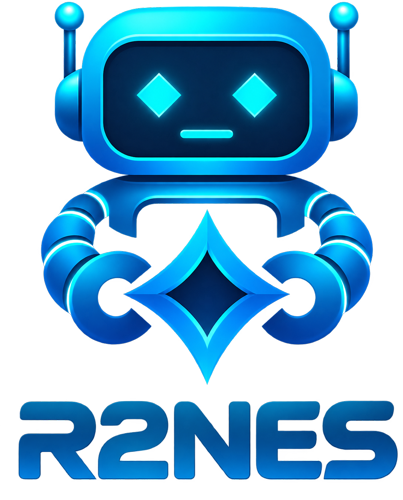
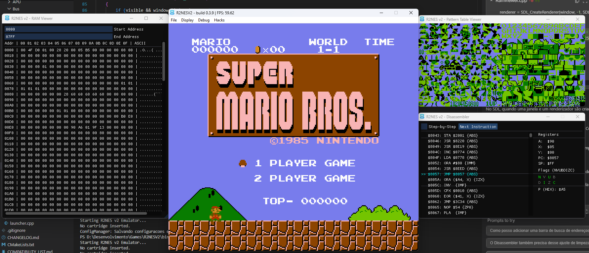
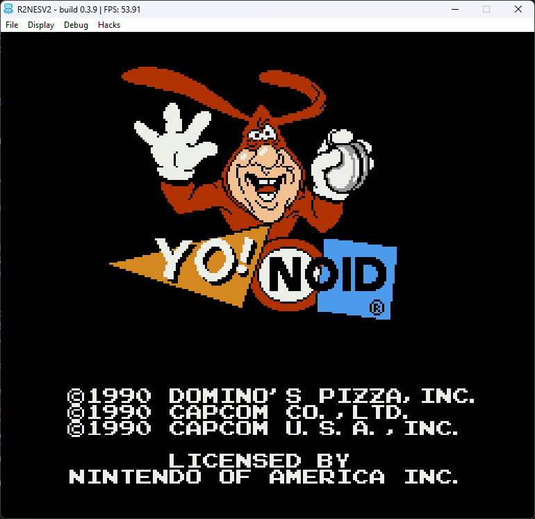
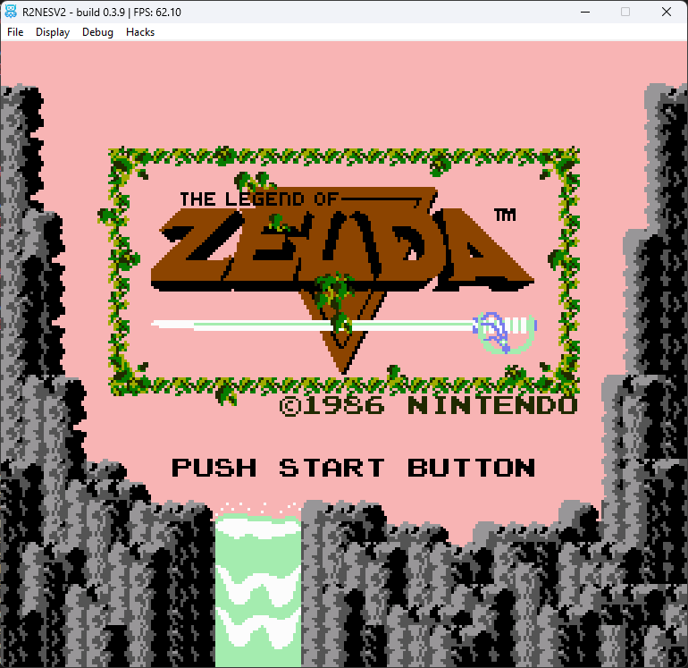

# R2NES V2

<div align="center">
  
</div>

R2NES V2 is a NES emulator written in C++17, using SDL3 and Dear ImGui. It runs on Windows and Linux and includes save states, battery saves, rewind, gamepad support, and debugging tools.

[Download releases](https://github.com/jpaulobf/R2NESV2/releases) · [Compatibility](COMPATIBILITY_LIST.md) · [Changelog](CHANGELOG.md) · [Test documentation](tests/README.md)

**Accuracy Coin: 147/147 tests passed** in the documented NTSC run on November 15, 2026. See the [results and test conditions](docs/ACCURACYCOIN_RESULTS.md) for details.

## Features

- Cycle-based CPU bus accesses synchronized with the PPU, including interrupt and DMA timing.
- Background and sprite rendering, scrolling, Sprite 0 Hit, selectable palettes and scanlines, and detailed PPU register and OAM behavior.
- Pulse, triangle, noise, and DMC audio, with individual channel controls, plus Sunsoft 5B expansion audio.
- Selectable NTSC and PAL console timing under **Display → Console Region**; changing region resets the console.
- Configurable keyboard controls, up to two gamepads, turbo buttons, and mouse-controlled Zapper.
- Three save-state slots, battery saves for supported boards, rewind with selectable precision, fast forward, and optional CPU overclock.
- Game Genie and RAM cheats, with master and individual entry controls.
- CPU disassembler and viewers for RAM, VRAM, OAM, palettes, and pattern tables.
- iNES/NES 2.0 and supported UNIF images, loaded directly or from ZIP archives. UNIF is detected by content, including images named `.nes`.

ROM images are limited to 64 MiB and ZIP archives to 128 MiB. ZIP loading
supports stored and DEFLATE entries, including data descriptors, and checks
sizes and CRC. Encrypted, multi-disk and ZIP64 archives are not supported.

Implemented mapper IDs: **0, 1, 2, 3, 4, 5, 7, 9, 11, 23, 27, 40, 51, 52, 58, 66, 69, 71, 79, 83, 90, 91, 147, 150, 187, 189, 202, 210, 211, and 212**. Supported UNIF boards include `CNROM`, `SA-016-1M`, `TC-U01-1.5M`, and `Sachen-74LS374N`. Board variants and supported memory sizes vary; see the [test documentation](tests/README.md).

Recent accuracy work covers CPU interrupts and unofficial instructions, OAM and DMC DMA, APU frame and DMC timing, and PPU register, rendering and sprite evaluation behavior. Regression tests exercise cycle timing, open bus, state restoration and mapper behavior. Optimizations also reduce rewind allocations, repeated CPU instruction classification and PPU bookkeeping; performance gains depend on the game and settings.

## Playing

Load a `.nes`, `.unf`, `.unif`, or `.zip` image from the **File** menu. Enable rewind, fast forward, or the Zapper from their menu options before using them. ROMs are not distributed with release packages.

| Action | Default keyboard control |
| --- | --- |
| Direction | W / S / A / D |
| A / B | K / J |
| Turbo A / Turbo B | I / U |
| Select / Start | Backspace / Enter |
| Fast forward | Hold Tab |
| Rewind | Hold Caps Lock |
| Pause | P or Pause |
| Save state / Load state | F5 / F6 |
| Window scale | F7–F10 |
| Borderless fullscreen | F11 |
| Reset | F12 |
| Zapper trigger | Left mouse button |

Gamepads support directional and action buttons, Start/Back, and turbo controls. Configure keyboard bindings under **Input → Configure Keyboard**, choose the save-state slot under **File → Save State Slot**, and enable the Zapper under **Input**.

Save states are stored in `savestates/`. Battery saves use `battery/<ROM CRC32>.sav`, relative to the working directory, and are written on ROM replacement, unload, or normal exit. Battery persistence covers mappers 1, 4, 5, 23, 27, 52, 69 and 210 when battery-backed RAM is present, and explicitly declared mapper 9 RAM extensions; standard Punch-Out!! has no battery. Read/write failures are shown in the interface.

## Compatibility

R2NES is actively developed. Mapper support and the Accuracy Coin result do not guarantee that every game or hardware behavior is reproduced correctly. The documented Accuracy Coin run targets NTSC; PAL timing and board coverage are not fully validated.

- NTSC save states use `R2Na` and PAL states use `R2Nb`. States cannot be exchanged between regions. Older formats are rejected, and earlier emulator versions cannot read the current formats.
- Unlimited Sprites changes hardware behavior. Disable it when checking normal sprite limits and compatibility.
- Mapper 23 supports the iNES VRC4-compatible superset and NES 2.0 submappers 1 (VRC4f), 2 (VRC4e) and 3 (VRC2b); see the [test documentation](tests/README.md) for memory limits. Mapper 147 supports the 72-pin latch variant; the JV001 variant is not implemented. Mapper 150 supports the CPU D2 pad setting.
- Mapper 27 uses the VRC4 core with direct A0/A1 decoding. Mapper 52 supports the MMC3 multicart variant; mixed CHR-ROM/CHR-RAM submappers are not implemented. Mapper 83 supports single-game submappers 0 and 1, while mapper 91 supports submapper 0. Mapper 210 supports Namco 175 and 340 boards.
- Known legacy dumps of *Mortal Kombat 2* (CRC `60BFEB0C`) and *Mario 7-in-1* (CRC `68FE207F`) receive content-specific mapper or CHR bank-order corrections. The original ROM and its save identifier are preserved.
- Video uses SDL3's `SDL_Renderer`. On Windows, the built-in shader effects use Direct3D 11 and include Scanlines, HQ2, ScaleFX, CRT and CRT 3D.

See the [compatibility list](COMPATIBILITY_LIST.md) for game observations and the [test documentation](tests/README.md) for board details, automated checks, and known limitations.

## Build from source

Requirements: **CMake 3.16+**, **GCC/G++ with C++17 support**, **Git**, and internet access for the first dependency download. CMake fetches SDL **3.4.18**, Dear ImGui **1.93.0**, and zlib **1.3.1**. SDL3 is linked statically with its GPU API enabled.

### Windows (MinGW-w64)

With GCC, G++, and `mingw32-make` on `PATH`, run from the repository root:

```powershell
cmake -S . -B build -G "MinGW Makefiles" -DCMAKE_BUILD_TYPE=Release
cmake --build build --parallel
```

### Linux

Install GCC/G++, CMake, Git, and the SDL3 development dependencies listed in the [release workflow](.github/workflows/release.yml), then run:

```bash
bash build-linux.sh
```

The script builds in `build-linux/`. Alternatively, configure and build manually:

```bash
cmake -S . -B build-linux -DCMAKE_BUILD_TYPE=Release
cmake --build build-linux --parallel
```

The executable and resources are placed in `bin/`. Keep the `resources/` and `shaders/` directories beside the executable.

### Core-only build

To build the shared emulation core and its tests without SDL3, Dear ImGui, or
the desktop application:

```bash
cmake -S . -B build-headless -DCMAKE_BUILD_TYPE=Release -DR2NES_BUILD_GUI=OFF
cmake --build build-headless --parallel
ctest --test-dir build-headless --output-on-failure
```

On Windows, add `-G "MinGW Makefiles"` if using MinGW. The core still uses
zlib for ZIP support; CMake fetches it on the first configuration. Headless
test executables are placed in `build-headless/bin/`. SDL audio, event and
window integration tests are available only with `R2NES_BUILD_GUI=ON` (the
default). The snapshot buffer and core tests run in both configurations.

### Tests

Tests are enabled by default. After building, run:

```bash
ctest --test-dir build --output-on-failure
# For the Linux build directory:
ctest --test-dir build-linux --output-on-failure
```

The SDL integration test uses dummy audio/video drivers, software rendering, and virtual gamepads, so it can run without a desktop session. More details and individual test commands are in [tests/README.md](tests/README.md).

## Screenshots







## License

GNU General Public License v3.0. See [LICENSE](LICENSE).
