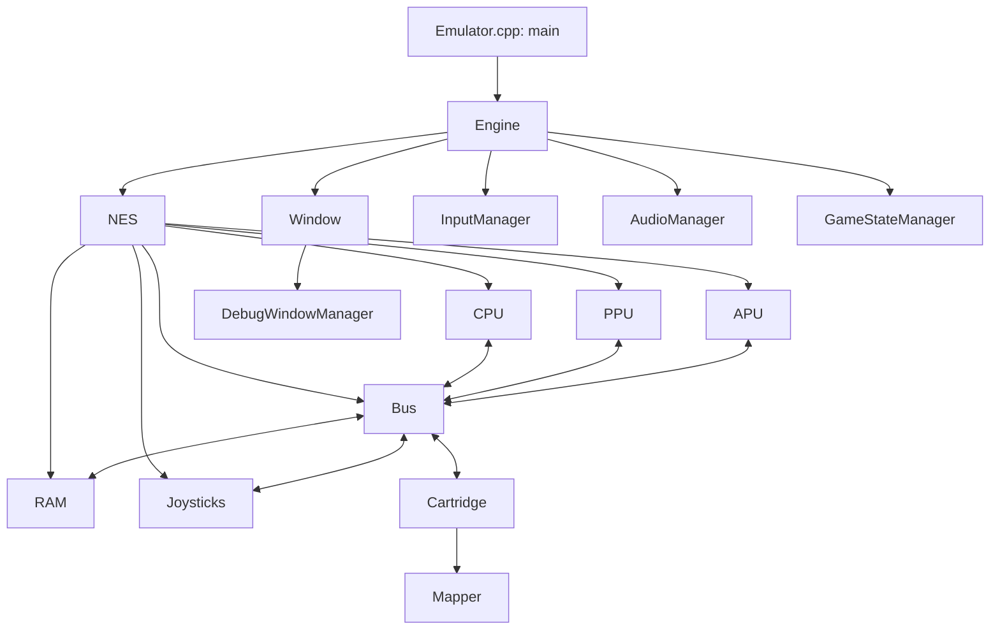

# Arquitetura do R2NES V2

Panorama do projeto para orientar o desenvolvimento e retomar o contexto em novas conversas. Baseado no código presente no workspace em 15/10/2026, incluindo alterações locais ainda não commitadas. Atualize este arquivo quando mudarem responsabilidades, fluxos ou decisões importantes.

## Visão geral

O R2NES V2 é um emulador de Nintendo Entertainment System escrito em C++17, com interface desktop, áudio, controles, save states, rewind e ferramentas de depuração. A cadência principal tem como referência o NES NTSC.

O trabalho atual envolve precisão de CPU/PPU/APU, comportamento dos mappers e compatibilidade com jogos. Ter um mapper implementado ou um teste de inicialização aprovado não significa compatibilidade completa com todos os jogos dessa placa.

## Organização do código

| Local | Responsabilidade |
| --- | --- |
| `src/Emulator.cpp` | Entrada da aplicação: cria a `Engine` e chama `run()`. |
| `src/Core/NES.*` | Montagem do console e coordenação de clocks, DMA, interrupções e serialização. |
| `src/Core/CPU/` | CPU Ricoh 2A03, execução das instruções e tratamento de interrupções. |
| `src/Core/PPU/` | Vídeo, registradores, background, sprites e framebuffer. |
| `src/Core/APU/` | Canais de áudio, sequenciador, DMC e geração de amostras. |
| `src/Core/Bus/` | Acessos à memória e comunicação entre os dispositivos. |
| `src/Core/Memory/` | RAM interna e VRAM. |
| `src/Core/Cartridge/` | Carregamento de ROMs, PRG/CHR, seleção de mapper e memória do cartucho. |
| `src/Core/Cartridge/Mappers/` | Bancos de memória, espelhamento, registradores e IRQs específicos das placas. |
| `src/Core/IO/` | Estado e protocolo dos controles emulados e seleção do dispositivo da porta 2. |
| `src/System/` | Loop da aplicação, entrada física, reprodução de áudio e gerenciamento de ROM/save states. |
| `src/Window/` | Janela principal, menus e visualizadores de depuração. |
| `src/Util/` | Configuração, utilitários e apoio ao diagnóstico. |
| `src/Common/` | Definições compartilhadas. |
| `resources/` | Recursos da interface e arquivo de configuração. |
| `tests/` | Testes de regressão e notas técnicas de revisão. |

Os nomes de namespaces nem sempre coincidem com as pastas: `Engine` e `Window`, por exemplo, pertencem a `R2NES::Core`, apesar de ficarem em `System/` e `Window/`.

## Componentes e conexões

O [diagrama detalhado em Mermaid](diagram.mmd) apresenta os componentes agrupados por área, suas relações de posse e comunicação e links para o código. A legenda distingue os tipos de seta. O esquema abaixo oferece uma visão resumida dessas conexões.

A `Engine` possui `Window`, `NES` e os três gerenciadores por `unique_ptr`. O `NES` contém seus dispositivos como membros e conecta suas referências no construtor. O `Bus` mantém ponteiros para os dispositivos conectados e um `shared_ptr` para o cartucho.

### Núcleo do console

- **NES:** fornece a fachada para avançar o console, carregar/remover cartuchos, resetar e salvar/restaurar estados. Coordena IRQs da APU e do cartucho, NMI da PPU e transferências DMA.
- **Bus:** encaminha leituras e escritas da CPU, consulta primeiro o cartucho e trata RAM, registradores da PPU/APU e controles. Guarda o latch do barramento de dados da CPU e contadores usados no timing.
- **CPU:** distribui os acessos ao barramento pelos ciclos das instruções. Polling de IRQ e captura de NMI dependem do ciclo em que os eventos ocorrem.
- **PPU:** produz o framebuffer de 256 × 240 pixels, executa a lógica de vídeo e informa endereços/acessos ao cartucho. Essas notificações afetam, por exemplo, IRQs do MMC3 e latches do MMC2.
- **APU:** emula Pulse 1, Pulse 2, Triangle, Noise e DMC. Produz amostras para reprodução e solicita DMA para buscar dados do DMC.
- **Cartridge e Mapper:** o cartucho carrega e valida a imagem, mantém os dados e delega à implementação da placa a tradução dos endereços, bancos, espelhamento e comportamento adicional.

### Aplicação e interface

- **Engine:** processa entrada e solicitações da interface, agenda emulação/renderização e coordena pausa, execução por instrução, fast-forward e rewind.
- **InputManager:** converte teclado e controles SDL em botões do NES, aplica turbo por quadro emulado e configura a Zapper na segunda porta.
- **AudioManager:** abre o dispositivo SDL e enfileira as amostras produzidas pela APU.
- **GameStateManager:** coordena abertura/remoção/reset da ROM, arquivos de save state e cache do disassembly.
- **Window:** gerencia SDL, apresentação do framebuffer, menus, opções e callbacks usados pela `Engine`.
- **DebugWindowManager:** mantém os viewers de RAM, VRAM, OAM, paleta, tiles e disassembly. `ScopedImGuiContext` auxilia a troca de contexto ImGui.
- **ConfigManager:** lê e grava `resources/config.ini`, incluindo ROMs recentes e último diretório utilizado.

## Fluxo de execução e timing

1. `main()` cria a `Engine`, que monta o console, a janela e os gerenciadores e conecta os callbacks.
2. `Engine::run()` processa eventos e decide quando atualizar a emulação e renderizar.
3. Em execução normal, `Engine::update()` chama `NES::step()` até a PPU completar um quadro.
4. A aplicação recolhe as amostras da APU, atualiza o contador de quadros usado pelo turbo e captura snapshots quando o rewind está habilitado.
5. `Engine::render()` apresenta o framebuffer e atualiza os viewers abertos.

Um `NES::step()` representa um passo do sistema: normalmente avança um ciclo da CPU, três clocks da PPU e um passo da APU, além do tick do cartucho. DMA pode ocupar o ciclo da CPU enquanto os demais dispositivos continuam avançando. O contador `systemClockCounter` avança por passo; `cpuCycleCounter` acompanha os ciclos da CPU, inclusive DMA e ciclos extras de overclock.

O overclock experimental permite dois clocks da CPU por passo, mantendo a cadência da PPU/APU. O depurador usa `step(false)` para desconsiderar esse overclock e parar no limite de instrução, aguardando também o fim de OAM DMA.

A IRQ da CPU reflete as fontes da APU e do cartucho; aceitar a interrupção não reconhece automaticamente sua origem. A NMI sinalizada pela PPU é encaminhada à CPU para tratamento conforme a execução das instruções.

O loop usa espera por eventos entre prazos de trabalho e limita os lotes de fast-forward para voltar ao processamento de eventos. Fast-forward suspende temporariamente o VSync e suprime a saída de áudio, preservando a execução dos canais, sequenciador e DMC. Transições como pausa, carregamento e reset limpam áudio pendente e acumuladores de tempo.

## ROMs e mappers

O carregador aceita `.nes` e `.zip` contendo uma imagem `.nes`. Interpreta cabeçalhos iNES e informações NES 2.0, com validações específicas por mapper; o reconhecimento do formato não implica suporte a todas as suas variantes.

Há implementações para os IDs **0, 1, 2, 3, 4, 5, 7, 9, 11, 23, 40, 66, 71, 90, 187 e 189**. A fábrica de seleção fica em `Cartridge.cpp`; a interface comum fica em `Mappers/Mapper.h`.

Alguns cuidados recorrentes:

- Conflitos de barramento, capacidade de RAM, bancos e espelhamento dependem da placa/submapper. As regras dos mappers 2, 3 e 7, por exemplo, não são intercambiáveis.
- Escritas consecutivas no MMC1 usam o contador de ciclos da CPU.
- IRQs do MMC3 dependem das transições de endereço da PPU e da filtragem de A12.
- Leituras da PPU podem alterar latches do MMC2. Consultas dos viewers devem usar os caminhos de inspeção apropriados, como `ppuPeek`, sem disparar esses efeitos.
- Existem exceções de compatibilidade por hash. Um dump iNES com CRC32 `96CE586E` declara mapper 187 e é selecionado como 189 pelo carregador. Workarounds desse tipo precisam continuar delimitados à ROM identificada.

## Save states e rewind

O `NES` serializa o estado em arquivo ou stream. O formato atual usa o identificador numérico `0x52324E43`, chamado `R2NC` no código, e inclui os contadores do sistema/CPU, latch do barramento, CPU, RAM, PPU, APU, mapper e cartucho, nessa ordem.

A leitura também aceita o formato anterior `R2NB` (`0x52324E42`), sujeito à configuração e validação dos componentes. Builds antigos não leem `R2NC`. Em caso de falha no carregamento, o `NES` tenta restaurar o snapshot anterior para evitar um console parcialmente carregado.

O `GameStateManager` usa três slots em `savestates/<nome-da-rom>.<slot>.sav`. Esses arquivos são snapshots do console; ainda não existe persistência automática separada da memória de bateria do cartucho.

O rewind reutiliza a serialização em streams e mantém um histórico limitado em memória na `Engine`. Só captura estados quando habilitado. Carregar ROM/save state, resetar, remover cartucho ou desabilitar o recurso descarta o histórico anterior.

## Build e verificação

O projeto usa CMake 3.16 ou superior e C++17. O `CMakeLists.txt` configura GCC/G++ e obtém as dependências por `FetchContent`: SDL3 `release-3.4.18`, Dear ImGui `v1.93.0` e zlib `v1.3.1`. O executável e os recursos copiados ficam em `bin/`. Há instruções de build para Windows/MinGW e Linux no [README](README.md).

A interface usa os backends ImGui `sdl3` e `sdlrenderer3`. O áudio recebe amostras mono float de 44,1 kHz por `SDL_AudioStream`, que faz a conversão para o dispositivo físico. Os gamepads são associados aos jogadores por `SDL_JoystickID`. A sessão SDL permanece ativa até que todos os viewers tenham sido destruídos. A API GPU está habilitada no build; a renderização atual continua usando `SDL_Renderer`, com shaders GPU previstos para uma alteração futura.

Os testes usam ROMs sintéticas e, em alguns casos, ROMs externas opcionais para diagnósticos ou inicialização. Existem alvos CMake/CTest para os mappers 1, 2, 3, 4, 7 e 9; outros testes possuem comandos próprios documentados em [tests/README.md](tests/README.md), incluindo mapper 71/189, sprite overflow, espera de eventos e supressão de áudio.

Ao alterar timing ou mapeamento, a verificação deve exercitar os acessos reais envolvidos. Resultados de testes sintéticos, diagnósticos de hardware, inicialização e partidas completas representam evidências diferentes de compatibilidade.

## Limitações e cuidados para continuar o trabalho

- A precisão de timing e a cobertura dos mappers continuam em evolução.
- A arbitragem de DMA entre DMC e OAM ainda não é modelada integralmente ciclo a ciclo.
- O sprite overflow não reproduz integralmente o bug do hardware. Unlimited Sprites altera o limite visual normal de oito sprites por scanline, embora preserve a sinalização do nono sprite.
- `NES::reset()` faz uma inicialização determinística completa; um reset elétrico a quente exigiria tratamento próprio.
- O glitch de recarga do MMC3 por escritas consecutivas em `$C001` e falhas de diagnósticos gerais de CPU/APU estão registrados na documentação de testes.
- Mudanças na serialização precisam considerar ordem, tamanho, validação e leitura dos estados anteriores.
- Caminhos de inspeção devem preservar o estado da emulação; leituras normais podem ter efeitos colaterais.

## Documentos para retomar o contexto

| Documento | Uso |
| --- | --- |
| [README.md](README.md) | Recursos, build e controles. |
| [CHANGELOG.md](CHANGELOG.md) | Histórico de mudanças e limitações registradas. |
| [COMPATIBILITY_LIST.md](COMPATIBILITY_LIST.md) | Observações de compatibilidade por jogo. |
| [tests/README.md](tests/README.md) | Comandos de teste, cobertura e resultados de diagnóstico. |

Para iniciar uma nova conversa, este arquivo dá o mapa geral. O código e os documentos específicos acima devem ser consultados para confirmar os detalhes da área que será alterada. Registre aqui mudanças estruturais e decisões duradouras; use o changelog para o histórico e a lista de compatibilidade para resultados por jogo.
